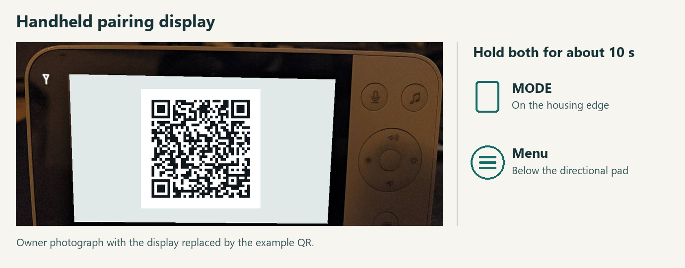
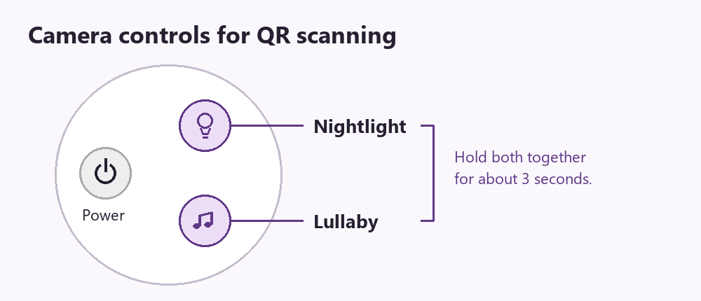
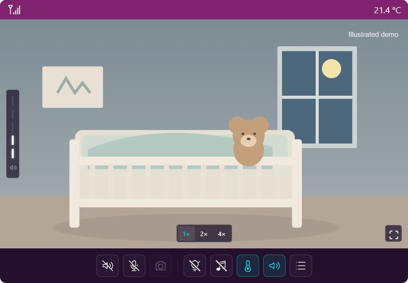

# Philips Avent SCD923/26 Baby Monitor for Home Assistant

> [!IMPORTANT]
> Setup requires the baby unit's **16-character local pairing key**. You can get it from the parent unit's QR code by following the [pairing guide below](#get-the-local-pairing-key).

**Avent local** connects Home Assistant directly to your Philips Avent SCD923/26 over your home network. The dashboard card shows live video, room audio, temperature and Wi-Fi reception, with controls for talkback, the night light and lullabies.

**No Tuya Cloud or internet connection is required for local use.** Once the integration and its dependencies are installed, Home Assistant communicates with the baby unit over the LAN, and you can open the dashboard from a browser or phone on the same network. HACS needs internet access to download the integration and its updates from GitHub.

> [!WARNING]
> **Use the Home Assistant live view and the original parent unit in turn.** When both try to use the camera at the same time, they can compete for the connection and the live picture or audio can drop. Before switching back to the handheld, close **all** Home Assistant live views and wait about **10 seconds** for the integration to release the camera. If a browser or phone disconnected abruptly, allow extra time for the lost session to be detected. Check that the handheld has live picture and sound before relying on it.

## Get the local pairing key

This sequence worked on a Philips Avent SCD923/26. Opening the QR screen creates **new Wi-Fi credentials** and can interrupt monitoring. Choose a time when you can take the monitor offline. If you already have a working key, you can use it directly during [installation](#install-with-hacs).

1. **Switch the handheld parent unit to direct-only mode first.** Let it reconnect to the baby unit before opening the QR screen. If a Home Assistant live view is open, close it and allow about ten seconds for it to release the camera.
2. **Generate the QR code on the handheld.** From the video or mode view, hold **MODE** (the elongated edge button beside a rectangle) and **Menu** (the round ≡ button below the directional pad) together for about **10 seconds**. Leave the code on screen.

   

   *Hold MODE and Menu together. The display in this photo has been replaced with a synthetic example QR code.*

3. **Read the key locally.** Photograph the display or use an offline QR reader that shows the decoded text. The text is a JSON object. Copy the **16 characters inside the quotes after `"passwd"`**, exactly as shown. Keep the photo and key private.

   The QR code in the example image decodes to the following synthetic data. Use the `passwd` from your own handheld's current QR code during setup.

   ```json
   {
     "dev": "pu",
     "ssid": "example-direct-link",
     "passwd": "ExampleOnly00001"
   }
   ```

4. **Let the baby unit scan the same code.** On the camera, hold **Nightlight** and **Lullaby** (music note) together for about **3 seconds**. When the nightlight pulses orange, show the handheld display to the camera. After the confirmation tone, keep the QR dialog open and wait for the handheld's live picture to return. Pressing the centre **OK** button cancels a pending attempt.

   

5. **Enter the key in Home Assistant.** For a new setup, use the key in the installation steps below. For an existing entry, go to **Settings → Devices & services → Avent local → ⋮ → Reconfigure**, keep the camera's current LAN address and paste the key as plain text. The integration checks the key against the camera before saving it.

If the camera beeps but the handheld never reconnects, the camera may already have accepted the new key. The handheld reverts to its previous credentials when a pending attempt times out after **five minutes**. To retry, start in direct-only mode and use the freshly displayed code for both the camera scan and the Home Assistant key. Each new QR dialog generates a different pairing attempt.

## Install with HACS

[](https://my.home-assistant.io/redirect/hacs_repository/?owner=H3adsho0ot&repository=ha-local-babyphone&category=integration)

1. With [HACS](https://www.hacs.xyz/docs/use/download/download/) installed, use the button above to open **Avent local** in HACS and select **Download**. For manual registration, open **HACS → ⋮ → Custom repositories**, add `https://github.com/H3adsho0ot/ha-local-babyphone` and choose **Integration**.
2. Restart Home Assistant.
3. Under **Settings → Devices & services → Add integration**, select **Avent local**.
4. Enter the baby unit's LAN IP address or hostname and its **16-byte local pairing key**. The form accepts 16 ASCII characters or `hex:` followed by 32 hexadecimal digits. Keep this key private, including when filing issues.
5. Reload the dashboard or reopen the Companion App. Add the **Avent local** card, then select the camera entity created during setup. The integration registers the card automatically.

For a manual installation, copy `custom_components/local_babyphone` from the [release](https://github.com/H3adsho0ot/ha-local-babyphone/releases) into your Home Assistant `config/custom_components/` directory. Continue at step 2.

## Using the card



*Card preview with an original illustration and simulated readings.*

Open the card to start a live view. Several Home Assistant viewers share the same native camera connection. After the last viewer leaves, the integration releases the connection. Camera-derived sensors and local sound detection are available while the session is active.

| Control | What it does |
| --- | --- |
| Speaker and microphone | Listening starts muted. Tap the speaker to listen or the microphone to talk. Browser microphone access requires HTTPS or localhost and microphone permission. Simultaneous room audio during talkback is unverified. |
| Zoom and snapshot | Choose 1×, 2× or 4×. Drag the zoomed image or use the arrow keys. Home centers it. The card remembers the zoom and position for each HA user and camera on that browser or app. Save a snapshot from a live picture. |
| Night light and sounds | Tap to toggle. Hold the icon for brightness, a sound selection or a timer. |
| Temperature and sound detection | Set temperature limits or adjust local sound detection. The LED column shows the incoming audio level. Recent events appear in the card. |

English and German are included. The card follows the viewer's Home Assistant language and falls back to English. Media-player titles follow the HA server language.

## Compatibility and connection limits

- Version **0.5.2** was tested with an **SCD923/26** and **Home Assistant 2026.10.2**. Compatibility with other models and firmware versions is unverified.
- Home Assistant needs LAN access to the baby unit on TCP ports 554, 6000, 8684, 8686 and 8687. Start with a browser on the same network. The card uses WebRTC with local ICE candidates.
- Optional address discovery broadcasts the baby unit's direct Wi-Fi SSID on UDP port 6100 when a connection is needed. This exposes the SSID to devices on the broadcast network. Automatic recovery after an IP change has yet to be verified on hardware. If discovery fails, configure the current LAN address.
- **Privacy mode can disconnect the baby unit from the LAN.** The privacy switch is exposed as an HA entity. Keep the paired handheld available to turn privacy off if remote access is lost.

## Legal notice and safety

Avent local is an independent community interoperability project. It is not affiliated with, endorsed by or supported by Philips, Avent or the Home Assistant project. Product names and trademarks belong to their respective owners and are used to identify compatible equipment.

Use the integration only with equipment and networks you own or have permission to access. Follow the manufacturer's instructions. Video, audio and alerts can be delayed, interrupted or unavailable. Do not rely on this integration as the sole means of monitoring a child or for safety-critical alerts.

Project code is provided under the [MIT License](LICENSE), as is and without warranty, to the extent permitted by applicable law. The bundled aiortc code retains its [BSD license and copyright notices](custom_components/local_babyphone/vendor/aiortc/LICENSE). No rights to third-party trademarks or firmware are granted by this release.
